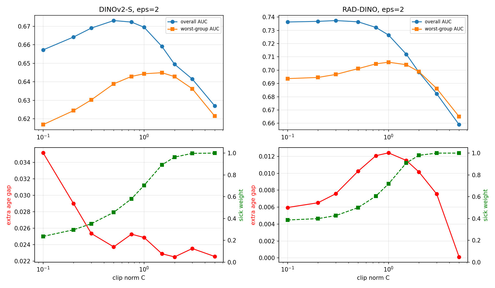

# Exploring DP fine-tuning on chest X-rays

A small exploration of **differentially private (DP) fine-tuning** on the NIH ChestX-ray14 dataset.
I train classifiers with DP-SGD and look at how the accuracy loss is distributed over patient groups (sex × age),
and which part of DP-SGD — **gradient clipping** or **noise** — is responsible.

The notebook: [`dp_finetuning_chest_xray.ipynb`](https://www.kaggle.com/code/atenazare/dp-fine-tuning-on-chest-xrays).

## Setup

- **Data:** NIH ChestX-ray14, 14 findings (multi-label). One random image per patient, so one training example = one
  patient and ε is a patient-level guarantee. Split by patient: train 65% (~20k patients), public 5%, val 10%, test 20% (~6k).
  The small *public* split is only used to standardize features, so that step costs no privacy.
- **Groups:** sex × age (<40, 40–59, 60+) → 6 groups.
- **Backbones (frozen):** DINOv2-S (generic, natural images) and RAD-DINO (pretrained on chest X-rays).
- **DP head:** a linear classifier on frozen features, trained with my own DP-SGD implementation
  (Poisson sampling, per-sample clipping, Gaussian noise, Adam). The noise multiplier comes from Opacus' RDP accountant, δ = 1e-5.
- **DP-LoRA:** LoRA (rank 8) on the query/value layers of DINOv2-S + the head, trained with Opacus.
- **Metric:** macro AUC per group over the 7 findings with enough positive cases in every test group.

## Results

### 1. Clipping down-weights sick patients — because of their error, not their features

RAD-DINO, ε = 2, C = 0.3 (averages over training):

| number of findings | clipped | gradient kept after clipping | error ‖p − y‖ | feature norm ‖x‖ |
|---|---|---|---|---|
| 0 | 91% | 41% | 0.80 | 1.41 |
| 1 | 100% | 19% | 1.18 | 1.42 |
| 2 | 100% | 15% | 1.40 | 1.44 |
| 3+ | 100% | 13% | 1.60 | 1.46 |

The error grows strongly with the number of findings while the feature norm hardly changes. Older patients have more
findings, so they keep the least of their gradient (60+: 28%, <40: 36%). DINOv2-S shows the same pattern
(60+: 43%, <40: 55%). In both backbones, clipping alone hurts the worst group more than noise alone.

### 2. Worst-group accuracy prefers less clipping than average accuracy does

At ε = 2, standard tuning (best average validation AUC) picks C = 0.3 (RAD-DINO) and C = 0.5 (DINOv2-S),
but the worst-group test AUC is highest at C = 1.0 and C = 1.5. The gain is small here (< 1 AUC point), while very large C
hurts everyone because the noise (σ·C) grows. The "sick weight" (kept gradient of patients with a finding relative to
healthy patients) goes from ~0.3 to 1.0 as C grows.

### 3. The age gap under DP depends on the backbone

| | non-private | ε = 8 | ε = 2 | ε = 1 |
|---|---|---|---|---|
| DINOv2-S, worst-group AUC | 0.670 | 0.639 | 0.639 | 0.630 |
| DINOv2-S, AUC gap (<40 minus 60+) | 0.019 | 0.043 | 0.042 | 0.046 |
| RAD-DINO, worst-group AUC | 0.705 | 0.682 | 0.697 | 0.693 |
| RAD-DINO, AUC gap (<40 minus 60+) | 0.073 | 0.089 | 0.081 | 0.081 |

- **DINOv2-S:** DP more than doubles the gap between young and old patients. Weakening clipping (larger C) reduces the extra
  gap from 3.5 to about 2.3 points; the rest remains even without clipping, so noise also plays a role.
- **RAD-DINO:** the extra gap is small (≤ 1.6 points) and within the noise of this test set. In an earlier version of the
  experiment with a larger test set (all images per patient) it was clearly larger (~4 points), so I see this effect as
  setup-dependent.

### 4. DP-LoRA needs much more data

On a subset of 6,000 training patients (ε = 8, 3 epochs):

| | worst-group AUC, non-private | worst-group AUC, ε = 8 |
|---|---|---|
| frozen DINOv2-S + DP head | 0.632 | 0.599 |
| DINOv2-S + DP-LoRA | 0.610 | 0.532 |

DP-LoRA loses much more than the DP head. Noise is added to every trained parameter: ~153k for LoRA vs ~5.4k for the head,
so relative to the signal the noise is about 5× larger — too much for 6,000 patients.

## Limitations

- One dataset; mostly a linear head on frozen features.
- Hyperparameter tuning (C, learning rate) is not counted in the privacy budget (common practice, but not strictly private).
- Test groups have only ~600–1,300 patients, so differences of 1–2 AUC points are within noise. Means over 3 seeds.
- Without regularization, the non-private head overfits rare findings; that's why I report AUCs on the common findings.
- The DP-LoRA part uses a 6,000-patient subset and only 3 epochs.

## How to run

1. Create a Kaggle notebook and upload `dp_finetuning_chest_xray.ipynb`.
2. Settings: GPU **T4** (not P100), Internet **on**.
3. Add the dataset **NIH Chest X-rays** (`nih-chest-xrays/data`).
4. Run all cells (≈ 30 min; ≈ 18 min with `USE_RADDINO = False`).

No data, features or model weights are stored in this repository.

## Notes

This project was developed with the help of an AI assistant (Claude); I ran the experiments and analysed the results.

Data and models are used under their own licenses: NIH ChestX-ray14 (NIH Clinical Center), DINOv2 (Meta AI),
RAD-DINO (Microsoft).
